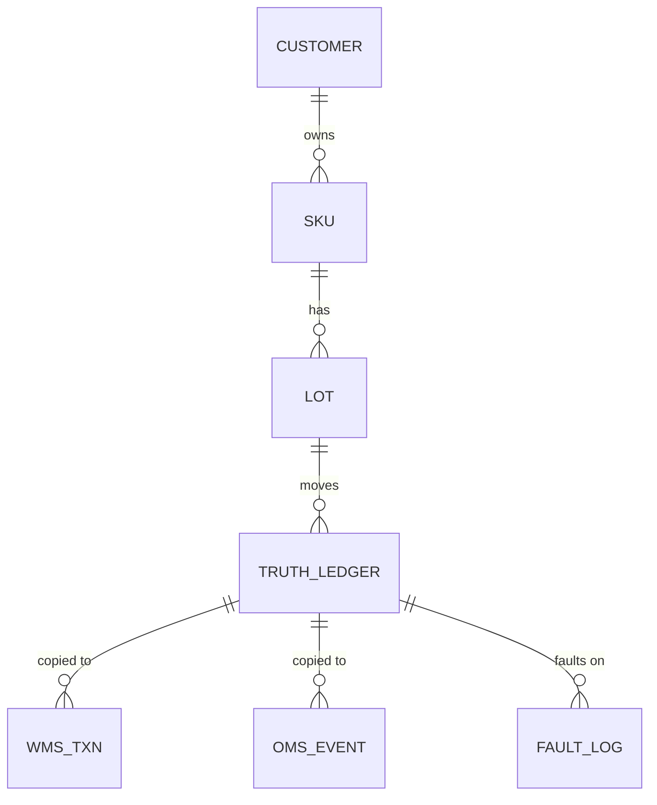

# Data Model

## Design principle
A true ledger is generated first. Each system's data is a copy
with faults injected. `fault_log` is the answer key used to
score the reconciliation pipeline.

## Tables
| Layer | Table | Purpose |
|---|---|---|
| Master | customers, skus, lots, warehouses | Reference data (SKU shelf life, lot expiry) |
| Truth | truth_ledger | What physically happened |
| Truth | fault_log | Injected faults (answer key) |
| Truth | cycle_count | Physical count per lot at period end |
| Source | wms_a_txn, wms_b_txn, wms_c_txn | Receipts, shipments and adjustments per warehouse system |
| Source | wms_a_snapshot, wms_b_snapshot, wms_c_snapshot | On-hand per lot as of period end (late-posted rows excluded) |
| Source | oms_event | Central order and inventory events across all warehouses |
| Source | oms_snapshot | Central on-hand per lot as of period end |

## System differences (cleaned in Silver)
- WMS-A: UTC timestamps, units
- WMS-B: local-time (WAT) text timestamps, different column names, units
- WMS-C: quantities in cases (converted via skus.units_per_case)
- OMS: UTC timestamps, units, covers all warehouses

## Scale
3 warehouses, 5 customers, 200 SKUs, ~600 lots, 90 days,
~150k transactions

## Injected faults (~3% of transactions)
| Fault | Share | How it appears |
|---|---|---|
| Missing | ~1% | Transaction absent from one system |
| Delayed | ~1% | Posted 2-10 days late |
| Duplicated | ~0.5% | Same transaction recorded twice |
| Incorrect | ~0.5% | Quantity typo (x10) or posted to the wrong lot |
| Physical loss | 15 lots | Stock disappears; no system records it |

## Validation
Faults cluster in 40% of lots; the rest stay clean. On those
clean lots (~60%), all systems and the physical count agree
exactly. The generator asserts this on every run.

## Entity relationships
