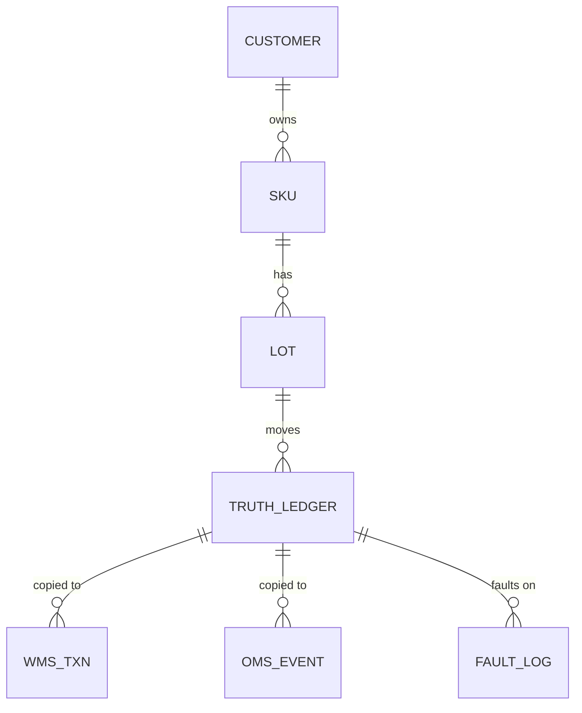

# Data Model

## Design principle
A true ledger is generated first. Each system's data is a copy
with faults injected. `fault_log` is the answer key used to
score the reconciliation pipeline.

## Tables
| Layer | Table | Purpose |
|---|---|---|
| Master | customers, skus, lots, warehouses | Reference data (SKU shelf life, lot expiry) |
| Truth | truth_ledger | What physically happened |
| Truth | fault_log | Injected faults (answer key) |
| Source | wms_a_txn, wms_b_txn, wms_c_txn | Receipts, shipments, adjustments, transfers |
| Source | wms_*_snapshot | Daily on-hand per customer/SKU/lot |
| Source | oms_event, oms_snapshot | Central order and stock view |

## System differences (cleaned in Silver)
- WMS-A: UTC timestamps, units
- WMS-B: local-time strings, units
- WMS-C: cases (converted via skus.units_per_case)

## Scale
3 warehouses, 5 customers, 200 SKUs, ~600 lots, 90 days,
~150k transactions

## Injected faults (~3% of transactions)
Missing 1%, delayed 1%, duplicated 0.5%, incorrect 0.5%,
plus a small set of lots with true physical loss.

